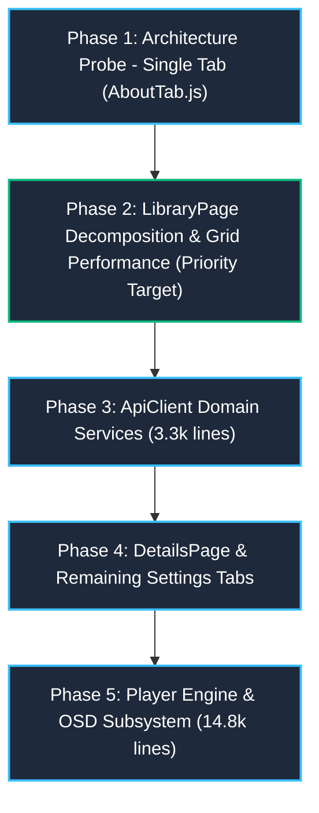

# Litefin Refactoring Roadmap & Zero-Regression Safety Protocol

## 1. Strategic Principles of the Great Refactor
Refactoring a codebase that targets 12 years of Smart TV platforms with single-core ARM CPUs and tight memory budgets cannot be done as a "big bang" rewrite. A single subtle regression in event handling, DOM recycling, or transpilation can crash ultra-legacy devices or cause severe memory leaks.

### The Five Golden Refactoring Laws
1. **Preserve Exact Behavioral Equivalence:**
   Do NOT alter user-facing behavior, keyboard mappings, UI styling, or API contracts while refactoring. Structural refactoring and feature additions must never be combined in the same commit.
2. **The Strangler Fig & Facade Pattern:**
   When decomposing a monolithic class (such as `SettingsPage` or `ApiClient`), keep the original class entry point intact. The original class becomes a thin facade that delegates calls to the newly extracted sub-modules:
   ```javascript
   // ApiClient.js remains the public interface, delegating to specialized services
   import { AuthService } from './services/AuthService.js';
   import { ItemsService } from './services/ItemsService.js';
   ```
3. **Atomic, Verifiable Steps:**
   Extract one subsystem at a time (e.g., a single tab in `SettingsPage`, or a single modal in `LibraryPage`). Verify test passes before proceeding to the next piece.
4. **No Phantom Dependencies:**
   Never invent new helper abstractions or base classes when existing services already exist. Reference [`src/utils/`](src/utils/), [`src/ui/`](src/ui/), and [`src/core/`](src/core/).
5. **CSS Freeze (Styles Kept to the Very End):**
   Do NOT touch, rename, or split stylesheets during JS architectural decomposition. Changing CSS in ultra-legacy TV runtimes causes brittle cascading failures in layout calculations, vendor prefixes, and spatial navigation math. All CSS remains frozen until all functional extractions are complete.

---

## 2. Phased Refactoring Roadmap



### Phase 1: Architecture Probe & Safety Baseline (`AboutTab.js`)
- **Target:** Extract just ONE simple tab from [`src/pages/SettingsPage.js`](src/pages/SettingsPage.js) (`AboutTab.js`) into `src/pages/settings/tabs/`.
- **Why First:** We do NOT need to extract all 14 Settings tabs before fixing actual performance bottlenecks. Testing the waters with one simple, self-contained tab verifies the multi-file architecture, Webpack build aliases across all tiers, and test harness compatibility with zero risk.
- **Milestones:**
  1. Create `src/pages/settings/tabs/AboutTab.js` and extract `_renderAboutTab()` logic.
  2. Import and mount `AboutTab` inside `SettingsPage.js`.
  3. Verify Webpack builds (`build:modern`, `build:legacy`) and run regression tests.

### Phase 2: LibraryPage Decomposition & Grid Performance (Priority Target)
- **Target:** [`src/pages/LibraryPage.js`](src/pages/LibraryPage.js) (6,849 lines -> < 250 lines orchestrator).
- **Goal:** Eliminate the library scroll lag bug immediately by decomposing the monolithic file and applying index-math navigation and pagination thresholds.
- **Milestones:**
  1. **Data Layer:** Extract `LibraryDataController.js` (manages API requests, pagination state, sort/filter state; zero DOM references).
  2. **Modals & Jump Bar:** Extract `LibraryModals.js` (Sort, Filter, ViewMode dialogs) and `LibraryAlphaPicker.js`.
  3. **Grid & Performance Controller:** Extract `LibraryGridController.js`:
     - **Pagination Threshold (<= 70 items):** Bypass `VirtualGrid` and `LazyLoader` completely. Render cards directly and stagger `img.src` assignment in chunks of 10–14 per frame so initial D-pad input is never blocked.
     - **Virtual / Infinite Threshold (> 70 items):** Maintain an `isNavigating` lock during active D-pad key repeats. Never mutate `img.src` while navigating; flush pending updates 150ms after the last keypress.
     - **Index-Math Spatial Navigation:** Use pure arithmetic (`index +- columns` / `+- 1`) inside the 2D grid instead of `getBoundingClientRect()` to prevent layout thrashing.
  4. **Orchestrator:** Reduce `LibraryPage.js` to a clean lifecycle orchestrator under 250 lines.

### Phase 3: API Client Domain Service Extraction
- **Target:** [`src/api/ApiClient.js`](src/api/ApiClient.js) (3,341 lines -> < 250 lines facade).
- **Goal:** Decouple backend requests into focused, typed domain services.
- **Milestones:**
  1. Extract `ApiClientCore.js` (HTTP transport, auth headers, retry watchdog).
  2. Extract domain services: `AuthService.js`, `ItemsService.js`, `PlaybackService.js`, `LiveTvService.js`, `LibraryService.js`, `ServerService.js`, `SyncPlayService.js`.
  3. Ensure `ApiClient.js` re-exports all methods as a facade for complete backward compatibility.

### Phase 4: Media Details & Full Settings Decomposition
- **Targets:**
  - [`src/pages/DetailsPage.js`](src/pages/DetailsPage.js) (6,275 lines -> < 250 lines orchestrator + hero, metadata, row controllers).
  - [`src/pages/SettingsPage.js`](src/pages/SettingsPage.js) (extract remaining 13 tabs and reusable widgets).
- **Milestones:**
  1. Extract `DetailsDataController.js`, `DetailsHeroSection.js`, `DetailsMetadataSection.js`, and `DetailsRowController.js`.
  2. Extract remaining settings tabs (`AppearanceTab`, `LayoutTab`, `PlayerTab`, `SubtitlesTab`, etc.) and widgets (`SettingsSlider`, `SettingsDropdown`).
  3. Split [`src/styles/settings.css`](src/styles/settings.css) (2.6k lines) into component-scoped stylesheets.

### Phase 5: Player Engine & OSD Subsystem Modularization
- **Targets:**
  - [`src/pages/PlayerPage.js`](src/pages/PlayerPage.js) (5,026 lines).
  - [`src/player/osd/OSDController.js`](src/player/osd/OSDController.js) (5,014 lines).
  - [`src/player/core/JellyfinPlayer.js`](src/player/core/JellyfinPlayer.js) (4,833 lines).
- **Safety Precondition:** Player changes require verification against the 20+ player test suites in `tests/`.
- **Milestones:**
  1. Decouple `OSDController` into `TimelineScrubController.js`, `FocusOverlayController.js`, and `OSDState.js`.
  2. Extract playback session watchdogs and network auto-recovery from `PlayerPage` into `PlaybackSessionController.js`.
  3. Keep hardware backends (`TizenAVPlayer`, `WebOSPlayer`, `MoviVideoPlayer`, `HtmlVideoPlayer`) strictly isolated behind the player abstraction layer.

---

## 3. Verification Protocol
After every extracted module:
1. **Unit & Integration Regression Suite:**
   Run tests: `npm test` (`node --test tests/*.test.js`).
2. **Build Integrity Verification:**
   Ensure Webpack builds compile cleanly across all tiers:
   - Modern tier (`build:modern`)
   - Normal tier (`build:normal`)
   - Legacy tier (`build:legacy`)
   - Ultra-legacy tier (`serve:ultra-legacy` dry run)
3. **Memory & Listener Leak Audit:**
   Verify that transitioning into and out of the refactored page leaves zero lingering listeners, intervals, or DOM nodes in detached state.
